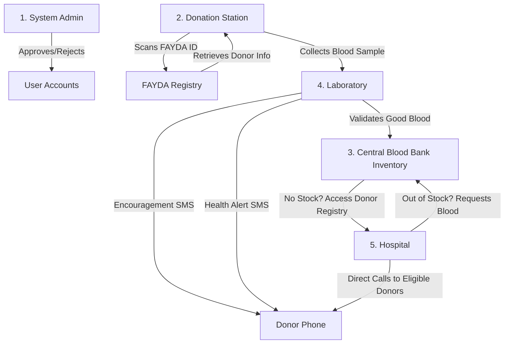

# Blood Bank & Emergency Response System (Revised 5-Actor, 2-Week Plan)

This updated plan incorporates the 5-actor architecture requested by your instructor, FAYDA (National ID) integration, SMSEthiopia API messaging with a strict single-message safeguard, and a central admin role.

---

## 1. System Architecture & The 5 Actors



### 👥 The 5 Actors & Login Portals
1.  **System Admin:**
    *   Approves or rejects new registrations for hospitals, stations, labs, and inventories.
    *   Monitors system logs, user activity, and blood stock statistics.
2.  **Donation Station:**
    *   Input donor's **FAYDA National ID** to auto-retrieve profile info (mock database fetch).
    *   Logs temporary collected blood samples and registers the donor.
    *   Ships collected blood samples to a Laboratory.
3.  **Laboratory:**
    *   Receives blood samples from Stations.
    *   Validates samples for diseases/defects:
        *   **If Safe:** Transfers blood count to the Central Blood Bank Inventory. Sends an **SMS Encouragement** quote (reminding them to donate every 3 months).
        *   **If Defective:** Discards sample. Sends a **Failed Notification** to the Inventory logs and sends an **SMS Health Warning** describing the health issue.
4.  **Central Blood Bank Inventory (Warehouse):**
    *   Stores validated blood stock categorized by type.
    *   Fulfills requests received from Hospitals.
5.  **Hospital:**
    *   Tracks internal inventory.
    *   Sends requests to the Central Blood Bank.
    *   **Fallback Action:** If the warehouse has zero stock, the hospital can access matching donor profiles (blood type + eligible > 3 months) to call them directly.

---

## 2. Technology Stack

For a clean, lightweight, and modern implementation that matches your stack requirement:
*   **Frontend:** React (Vite) + HTML + CSS + JavaScript.
*   **Backend:** Node.js + Express (serving endpoints for requests, labs, donor records, and FAYDA mock data).
*   **Database:** PostgreSQL (using `pg` driver or Sequelize ORM in the Node.js backend).

---

## 3. SMS Messaging (smsEthiopia) Policy
*   **API Endpoint:** `https://smsethiopia.com/api/sms/send`
*   **Authentication:** `KEY` header for authorization.
*   **One SMS Per Donation:** Donors should only receive exactly *one* SMS per donation cycle (once every 3 months, immediately following their donation and screening). The database tracks SMS logs linked to the specific `blood_sample_id` to ensure no duplicate SMS is sent for the same donation.

---

## 3. Database Schema Design (Supabase PostgreSQL)

```mermaid
erDiagram
    USERS {
        uuid id PK
        string email
        string role "admin | hospital | station | lab | warehouse"
        string status "pending | approved | rejected"
        string entity_name
    }

    DONORS {
        string fayda_id PK
        string name
        string phone UNIQUE
        date dob
        string gender
        string address
        date last_donation_date
        string blood_type
        string health_status "unknown | healthy | defective"
    }

    BLOOD_SAMPLES {
        uuid id PK
        string fayda_id FK
        string blood_type
        string status "collected | pending_lab | validated | discarded"
        string health_notes
        timestamp collected_at
    }

    WAREHOUSE_STOCK {
        uuid id PK
        string blood_type
        int quantity
    }

    HOSPITAL_REQUESTS {
        uuid id PK
        uuid hospital_id FK
        string blood_type
        int units_needed
        string status "pending | fulfilled | cancelled"
    }

    SENT_SMS_LOGS {
        uuid id PK
        string phone
        uuid blood_sample_id FK, UNIQUE
        string message_type "encouragement | warning"
        timestamp sent_at
    }
```

---

## 4. 2-Week Implementation Roadmap

### Week 1: Portal Login, FAYDA integration & Dashboards
*   **Day 1-2: Core DB Setup & Admin Dashboard**
    *   [ ] Set up tables in Supabase with mock data (4-10 hospitals, 3 labs, 2 warehouses).
    *   [ ] Create the unified login page.
    *   [ ] Build **Admin View**: Show tables of user accounts. Implement Approve/Reject actions.
*   **Day 3-4: Station & FAYDA Mock Registry**
    *   [ ] Build **Station View**: Implement the FAYDA National ID input field.
    *   [ ] Write a mock registry containing 5–10 FAYDA IDs (e.g. `ET-001`, `ET-002`). When typed, auto-populate the registration form.
    *   [ ] Station operators register blood samples and route them to "Pending Lab".
*   **Day 5: Laboratory Workstation**
    *   [ ] Build **Lab View**: Show list of pending blood samples.
    *   [ ] Provide controls for "Pass (Valid)" and "Fail (Defective)" status.

### Week 2: SMS Integration, Hospital Requests & Fallback
*   **Day 6-8: Lab Results, SMS Messaging & SMS De-duplication**
    *   [ ] Connect to SMSEthiopia API.
    *   [ ] Build backend check: If `blood_sample_id` already exists in `sent_sms_logs`, block sending.
    *   [ ] Send SMS 1 (Encouragement) upon successful validation.
    *   [ ] Send SMS 2 (Health alert detailing the defect) if validation fails.
*   **Day 9-10: Warehouse & Hospital Requests**
    *   [ ] Build **Warehouse Dashboard**: View validated stock levels. Fulfill hospital requests.
    *   [ ] Build **Hospital Dashboard**: Request low stock blood types.
*   **Day 11-12: Fallback Emergency Search**
    *   [ ] If Warehouse stock = 0, allow hospitals to toggle "Donor Access".
    *   [ ] Show eligible donors (matching blood type, last donation > 3 months) with phone numbers to call.
*   **Day 13-14: Polish & Deployment**
    *   [ ] Apply a visual crimson dark/light interface with crisp status indicators.
    *   [ ] Deploy on Vercel/Netlify. Verify end-to-end paths (Station -> Lab -> SMS -> Warehouse -> Hospital).
